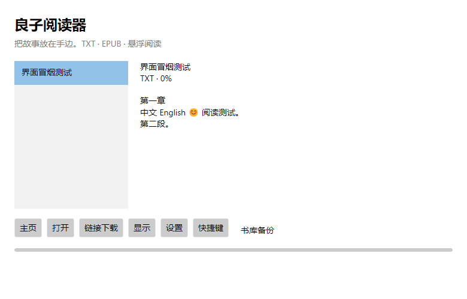
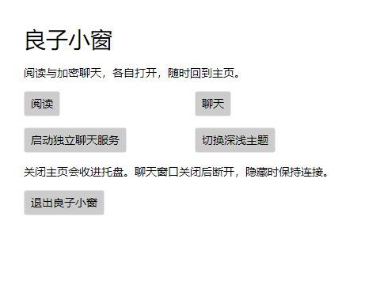
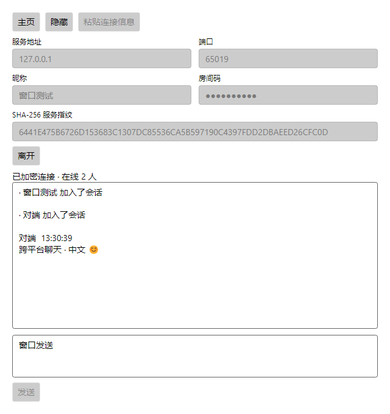

# 良子小窗（跨平台版）

适用于 Windows 和 macOS 的悬浮阅读与局域网加密聊天工具。基于上游 v1.5.2 迁移，保留 TXT / EPUB、进度保存、全局快捷键，并提供链接下载与跨平台书库备份。

**当前版本：2.3.3。** 基于上游 v1.5.2 迁移，原始源码保留在 [`legacy/v1.5.2/`](legacy/v1.5.2/)。Windows 与 macOS 的构建和回归检查由 CI 与发布流水线执行；Mac 实机交互、签名与公证尚未完成，具体限制见下方平台验证状态。

[发行版本](https://github.com/ch4pmanouninme-netizen/nengliang-reader/releases) · [提交问题](https://github.com/ch4pmanouninme-netizen/nengliang-reader/issues) · [更新日志](CHANGELOG.md) · [构建与发布](docs/RELEASE.md)

## 功能

v2.2.0 新增： VS Code 的 19 个与 JetBrains 的 8 个官方内置主题，按软件分组选择；阅读条也可独立选择这 27 套主题。选择自动保存，并保留原有自定义配色及旧配置兼容。来源、完整清单与映射范围见 [官方主题配色](docs/EDITOR-THEMES.md)。

- **统一主页**：阅读和聊天独立开关，关闭主页收进托盘，明确退出才关闭客户端。
- **加密聊天**：兼容上游 v1.5 协议，TLS 1.2、SHA-256 指纹校验、限流、有界缓存、自动重连。
- **独立服务**：Windows/macOS 均能启动聊天服务，客户端退出不影响独立服务。
- **本机部署**：仓库 `scripts/` 在桌面生成「启动 / 停止 / 更新」三个入口，代码固定装在本机一处，更新只需拉代码重启；详见 [团队内部部署](scripts/README.md)。

- **本地阅读**：TXT（UTF-8、UTF-16、GBK/GB18030）和 EPUB 纯文本导入，支持拖放。
- **书库管理**：右键书籍删除、置顶/取消置顶、新建或选择分组；左侧下拉框筛选全部书籍、未分组或指定分组。置顶与分组随进度保存并进入书库备份，详见 [书库管理](docs/BOOK-LIBRARY.md)。
- **悬浮阅读**：1～10 行显示、拖动定位、右边缘调整宽度、字号、透明度和多种外观。
- **阅读操作**：前后翻页、自动翻页、查找、百分比跳转，每本书一个书签。
- **快捷控制**：自定义全局快捷键、注册失败提示、鼠标穿透、托盘/菜单栏恢复入口。
- **进度保存**：本机自动保存、备份恢复、相同正文去重，兼容旧版书库。
- **链接下载**：粘贴无需登录的 TXT/EPUB 文件链接，显示进度，支持取消，完成后加入书架。
- **书库迁移**：导出 ZIP 备份，在另一台 Windows 或 Mac 上导入；重复书籍保留目的地进度。

暂不支持 PDF、加密 EPUB、纯图片书籍、在线书源搜索、小说网页抓取、云同步。EPUB 只提取正文，不保留原图文排版。

## 平台与验证状态

| 平台 | 构建目标 | 状态 |
| --- | --- | --- |
| Windows x64 | `win-x64` | 发布构建与窗口冒烟检查通过；真实热键、多屏、缩放待人工验收 |
| macOS Apple Silicon | `osx-arm64` | 自动构建与打包检查由发布流水线执行；签名、公证及实机交互验收未完成 |
| macOS Intel | `osx-x64` | 自动构建与打包检查由发布流水线执行；签名、公证及实机交互验收未完成 |

技术栈为 **.NET 10 + Avalonia 11.3.22**。自包含发行包无需用户额外安装 .NET。具体系统最低版本应符合 [.NET 10 支持平台](https://github.com/dotnet/core/blob/main/release-notes/10.0/supported-os.md)与 [Avalonia 平台要求](https://docs.avaloniaui.net/docs/supported-platforms)；本项目尚未对所有版本完成测试。

Mac 在 Spaces、全屏应用、睡眠唤醒及不同键盘布局下的行为需要单独验证。普通窗口置顶不代表能覆盖所有全屏应用。

当前验证记录见 [VALIDATION.md](docs/VALIDATION.md)。

## 界面预览

下图为 Windows 自动化冒烟检查中渲染的书架，使用内置测试正文。







## 下载与使用

在 [Releases](https://github.com/ch4pmanouninme-netizen/nengliang-reader/releases) 中选择对应平台。选择 v2.3.3 的平台安装包；Source code 为源码归档。

- Windows：完整解压 `NengliangReader-win-x64.zip`，运行根目录的 `良子小窗.exe`。根目录仅含 EXE、`README.md` 和 `app/`；请保留 `app/` 与 EXE 的相对位置，可为 EXE 创建桌面快捷方式。旧版发行包的入口仍为 `NengliangReader.exe`。
- Mac：根据芯片选择 `osx-arm64` 或 `osx-x64`，打开 DMG，将应用复制到“应用程序”。带 `unsigned` 的文件尚未完成 Developer ID 签名与 Apple 公证，系统可能阻止打开；请勿关闭系统安全保护。
- 本次 Release 的 Mac DMG 由 GitHub macOS runner 构建；自动打包通过不代表已完成 Apple Silicon / Intel 两种真机的交互验收。

### macOS 首次打开（unsigned 包）

两个 Mac DMG 均包含 `良子小窗.app`、`Applications` 快捷入口和 `README.md`。将应用拖入 Applications 后，从“应用程序”启动。

文件名带 `unsigned` 表示尚未完成 Developer ID 分发签名与 Apple 公证。仅在确认安装包来自本仓库且未遭篡改后，对“无法验证开发者”或“Apple 无法检查是否包含恶意软件”的提示，可按以下步骤操作：

1. 先尝试打开应用一次。
2. 打开“系统设置 → 隐私与安全性”，找到该应用对应的拦截提示，点击“仍要打开”。
3. 按系统提示验证身份并确认打开。系统会为此应用保存例外，不需要关闭全局安全保护。

该操作不会让应用变成已签名或已公证的软件。若提示“已损坏”“会损坏电脑”或发现恶意软件，请先停止运行、核对下载与校验值并反馈具体错误，不要直接按上述步骤放行。受管理设备可能不允许添加例外。

参考：[Apple 官方首次打开说明](https://support.apple.com/zh-cn/102445)。

### 本地阅读

1. 从主页进入“阅读”，点击“打开”选择 TXT/EPUB，或将文件拖入书架。
2. 选择书籍，点击“显示”。
3. 拖动阅读条调整位置，拖动右边缘调整宽度。
4. 右键打开翻页、书签、查找与设置菜单；双击阅读条返回书架。
5. 隐藏阅读条时自动暂停；在托盘或 Mac 菜单栏选择“主页”，再进入“阅读”可关闭穿透并恢复操作。

### 局域网聊天

1. 一位使用者从主页点击“启动独立聊天服务”，选择局域网网卡地址，点击“启动服务”。
2. 点击“复制连接信息”，通过可信渠道分享给参与者。默认端口为 `38417`；本机测试可选择 `127.0.0.1`。
3. 每位参与者从主页进入“聊天”，点击“粘贴连接信息”，填写昵称后连接。
4. Enter 发送，Shift+Enter 换行；“隐藏”或 Esc 保持连接；关闭聊天或“离开”断开连接并清空本机缓存。

Windows 可通过主页启动独立服务，或运行 `良子小窗.exe --server`；从源码可运行 `dotnet run --project src/Reader.Desktop -- --server`。Mac 已安装应用也可通过主页启动独立服务。

兼容上游 1.5.0 服务与 1.5.2 客户端的协议 v2，**不兼容 1.4 明文协议**。服务窗口内停止/启动保留证书和房间码；关闭后重开会更换，两端需重新分享信息。

默认最多 30 人、单条 500 字符、每连接每 10 秒 8 条消息。服务历史最多 100 条，客户端显示最多 150 条，待处理消息最多 182 条，每连接发送队列最多 160 条。断线后每 5 秒重试；错误指纹、错误房间码或重复昵称需用户修正后重连。重连只恢复服务端仍保留的历史，不保证消息不丢失。

TLS 保护客户端到服务端的传输，服务端可以读取消息，不是端到端加密。指纹必须通过可信渠道获取。应用不安装信任证书；Windows 使用用户密钥容器，macOS 使用 .NET 管理的临时钥匙串。详见 [跨平台证书说明](https://learn.microsoft.com/en-us/dotnet/standard/security/cross-platform-cryptography#read-a-pkcs12pfx)。

服务仅读取本机主题偏好，不写入书库。退出客户端不会停止独立服务；关闭服务会断开所有连接并清空服务历史。当前只实现文字聊天，无图片附件、账号或审计，不自动配置防火墙。

服务窗口可选启用**助手**。助手以普通成员身份、经由你在窗口里选中的监听地址加入房间（默认昵称“小助手”），因此人数上限、单条长度、限流与历史规则对它同样生效。这也意味着助手在局域网部署下照常工作：选中网卡地址后，房间里的其他人提问和助手回答走同一条链路。勾选“仅 @昵称 时回答”时，只有消息里出现 `@小助手` 才会触发；取消勾选则每条消息都会触发。回答按 480 字符分片依次广播，助手不回复自己发出的消息，房间不会因此循环。

助手需要一个 OpenAI 兼容的 `/v1/chat/completions` 端点。**端点必须使用 `https`，只有 `127.0.0.1` 允许 `http`**，因为密钥随请求头明文发送。回答由该服务生成后直接广播给全房间，没有人工审核，请不要把密钥交给不可信的端点。

### 链接下载

点击“链接下载”，粘贴 **HTTP/HTTPS 文件下载链接**。链接可以不带文件后缀，但服务器必须返回可识别的 TXT 或 EPUB 内容。小说介绍页、章节网页、需要登录的链接不适用。

下载最长等待 5 分钟，最多跟随 5 次重定向。TXT 导入上限 24 MB；EPUB 文件上限 100 MB，正文展开另有 24 MB 限制。失败后重新点击“链接下载”重试；当前版本不支持断点续传。

请仅下载你有权获取的电子书。软件不提供书源、账号登录或绕过付费的功能。

### 默认快捷键

Windows 使用 `Ctrl + Alt`，Mac 使用 `Control + Option`，再加下表按键：

| 按键 | 功能 |
| --- | --- |
| H | 隐藏 / 恢复此前可见的主页、阅读和聊天窗口 |
| → | 下一页 |
| ← | 上一页 |
| M | 切换鼠标穿透 |
| Space | 自动阅读 / 暂停 |

在书架“快捷键”中可以修改；注册失败会显示在书架底部。Mac 使用注册热键方式，键位表现仍需在目标键盘布局上验收。

阅读条获得焦点后，方向键/PageUp/PageDown 翻页，Space 切换自动阅读，Esc 隐藏；Ctrl（Mac 也支持 Command）+ B/J/F/G 分别保存书签、回书签、查找、跳转。

## 数据与隐私

| 系统 | 数据目录 |
| --- | --- |
| Windows | `%LOCALAPPDATA%\NengliangReader` |
| macOS | `~/Library/Application Support/NengliangReader` |

正文位于 `books/`，进度与偏好位于 `state.xml`，快捷键位于 `hotkeys.json`。保存使用临时文件替换并保留 `.bak`；损坏时优先读取备份。旧版程序旁边的 `data/` 目录会在目标书库不存在时复制迁移，保留原文件。

正常本地阅读不访问网络。链接下载访问目标服务器及重定向地址；聊天访问用户填写的服务地址；启动服务只监听所选网卡和端口；启用助手时会访问你填写的助手端点。不上传书库，不包含遥测或广告。开发时恢复依赖会连接 NuGet。聊天只保存地址、端口和昵称；不保存房间码、指纹和聊天正文。

助手设置单独保存在 `agent.xml`，包含端点、模型、昵称、触发方式和密钥。Windows 上密钥经 DPAPI 加密后写入，同一用户账户下的其他进程仍可解密；其他平台没有 DPAPI，密钥以明文保存并在文件中标记 `protected="false"`，请自行限制该文件的访问权限。关闭助手不会自动清除已保存的密钥。

使用“书库备份 → 导出书库”备份书籍与进度；导入时合并书籍，重复书籍不覆盖当前进度。备份不包含全局快捷键；导入不会覆盖目标设备外观或窗口位置。单个备份导入上限为展开后 256 MB。

## 从源码运行

先安装 [.NET 10 SDK](https://dotnet.microsoft.com/download/dotnet/10.0)，再执行：

```sh
git clone https://github.com/ch4pmanouninme-netizen/nengliang-reader.git
cd nengliang-reader
dotnet restore NengliangReader.sln --configfile NuGet.Config
dotnet build NengliangReader.sln -c Release --no-restore
dotnet run --project src/Reader.Desktop -c Release --no-build
```

上述命令适用于包含 2.x 源码的分支；若主分支尚未合并，请先切换到对应开发分支。

使用独立书库测试：

```sh
dotnet run --project src/Reader.Desktop -- --data ./artifacts/test-library
```

### 脚本入口（团队内部部署）

同事机器上不必每版都分发压缩包。克隆一次代码，双击 `scripts\install.bat` 在桌面生成
「启动 / 停止 / 更新」三个图标，之后点图标就行：**启动不联网**，更新才拉代码并编译。

代码装在 `%LOCALAPPDATA%\NengliangReaderCode\`，其中 `run\` 路径永久固定 —— Windows 防火墙的
入站规则按进程映像的完整路径匹配，路径不变，规则建一次就长期有效。书库数据仍在
`%LOCALAPPDATA%\NengliangReader\`，两边分开。每台机器需要 .NET SDK 10 和 Git。

失败不会破坏正在用的版本：拉取失败就地停下，编译失败把代码退回更新前那一版。前置条件、
回退方式和已知边界见 [scripts/README.md](scripts/README.md)。

## 测试与打包

```sh
dotnet run --project tests/Reader.Core.Tests -c Release
dotnet run --project tests/Reader.Chat.Tests -c Release
```

测试是控制台回归程序，失败返回非零退出码。覆盖编码、EPUB 章节顺序、分页、进度与备份、链接下载、取消、重定向和书库迁移。请使用 `dotnet run`，而非 `dotnet test`。

Windows：`pwsh ./build/package-windows.ps1`。Mac：`bash build/package-macos.sh osx-arm64` 或 `osx-x64`。详细签名、公证、验证清单和 GitHub 草稿发布流程见 [发布文档](docs/RELEASE.md)。

## 项目结构

```text
src/Reader.Core/               导入、阅读会话、存储、下载与书库备份
src/Reader.Chat/               v1.5 兼容协议、TLS、服务与客户端连接
src/Reader.Desktop/            Avalonia 界面与交互
src/Reader.Platform.Windows/   Windows 热键和鼠标穿透
src/Reader.Platform.Mac/       macOS 热键和鼠标穿透
tests/Reader.Core.Tests/       跨平台回归测试
tests/Reader.Chat.Tests/       TLS、协议边界与上游互通测试
scripts/                       启动 / 停止 / 更新脚本（团队内部部署）
build/                        安装包与签名脚本
docs/                         实施范围、验证与发布说明
legacy/                       历史 Windows Forms 源码，含 v1.5.2 快照
```

贡献方式见 [CONTRIBUTING.md](CONTRIBUTING.md)。反馈问题时请提供应用版本、系统/芯片、操作步骤及错误提示，不要公开个人书籍或敏感下载链接。

## 许可证

[MIT License](LICENSE)。依赖组件遵循各自许可证；许可不包含用户导入电子书的版权授权。
